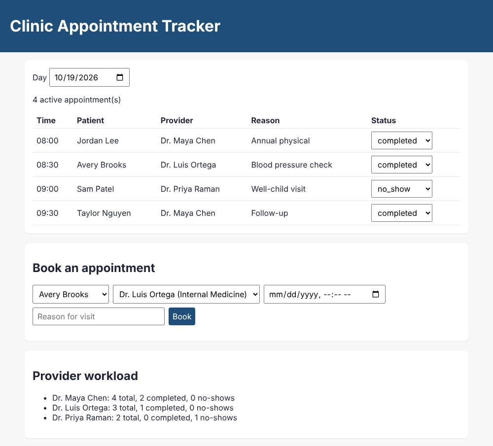

# Clinic Appointment Tracker

A small full stack app for scheduling clinic visits, based on my work as a Senior Medical Assistant. It shows a day's schedule, books appointments, updates visit status (checked in, completed, no-show), and reports each provider's workload.

**Tech:** SQL (SQLite) · Node.js REST API (built-in `http`, no frameworks) · vanilla JavaScript front end · `node:test` unit tests



## What it demonstrates

**SQL** ([`sql/`](sql))
- Relational schema with primary keys, foreign keys, `CHECK` and `UNIQUE` constraints (a provider can't be double-booked) and indexes
- `INNER JOIN` across three tables, `LEFT JOIN` + `IS NULL`, `GROUP BY` with `CASE` aggregates, `HAVING`, and a subquery — see [`sql/queries.sql`](sql/queries.sql)
- Parameterized queries (`?`) to prevent SQL injection

**JavaScript**
- `AppointmentRepository` class that owns all database access ([`src/AppointmentRepository.js`](src/AppointmentRepository.js))
- REST endpoints with input validation and proper status codes: 200, 201, 400, 404, 409 ([`src/server.js`](src/server.js))
- Front end using `fetch`, `async/await`, `Promise.all`, and array methods (`map`, `filter`, `reduce`) ([`public/app.js`](public/app.js))

## API

| Method | Endpoint | Description |
|---|---|---|
| GET | `/api/appointments?date=YYYY-MM-DD` | Day's schedule with patient and provider names |
| POST | `/api/appointments` | Book: `{ patientId, providerId, startsAt: "YYYY-MM-DD HH:MM", reason }` |
| PATCH | `/api/appointments/:id/status` | `{ status: "checked_in" }` |
| GET | `/api/reports/workload` | Total, completed and no-show counts per provider |
| GET | `/api/patients`, `/api/providers` | Lists for the booking form |

## Run it

Requires Node.js 22.13 or newer (uses the built-in `node:sqlite` module, so there is nothing to install).

```bash
npm start      # http://localhost:3000
npm test       # 8 unit tests
```

The database file `clinic.db` is created on first run with sample data (all names are fictional).

## Notes

Built with help from AI coding tools for planning, code review and tests.
