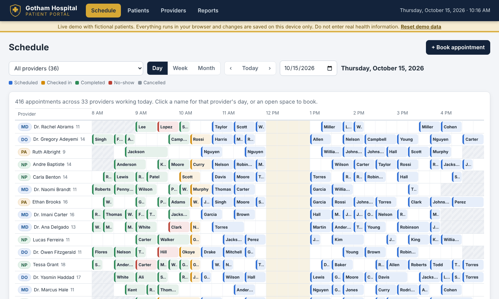
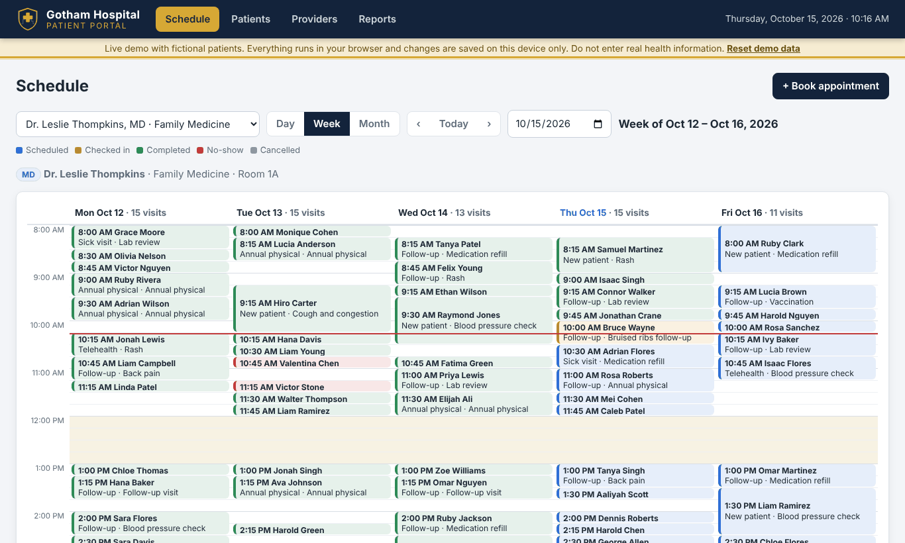
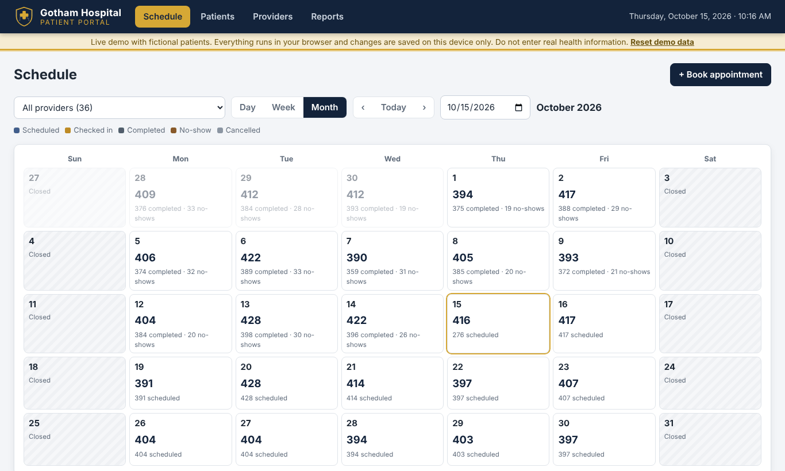
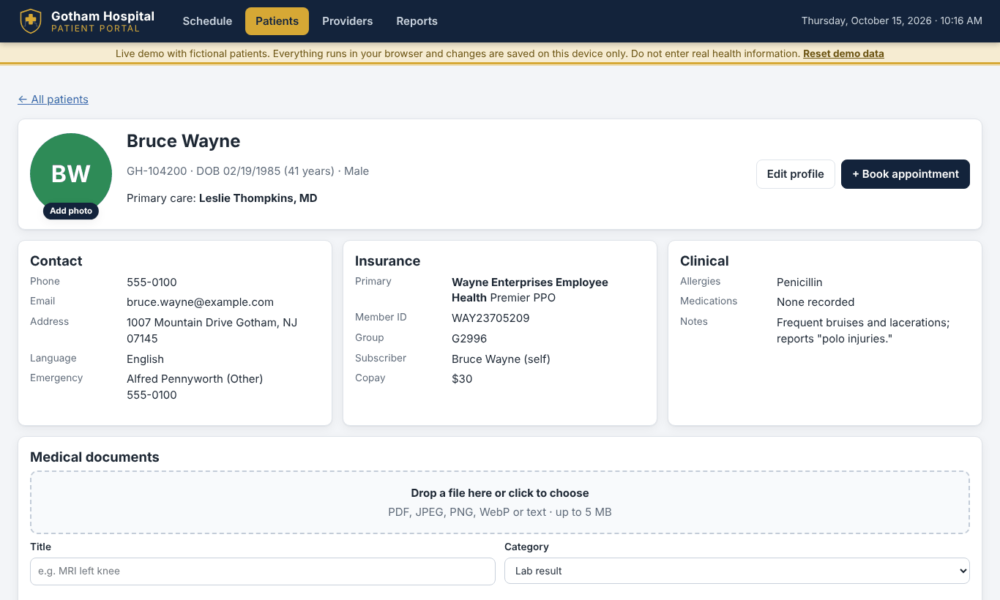
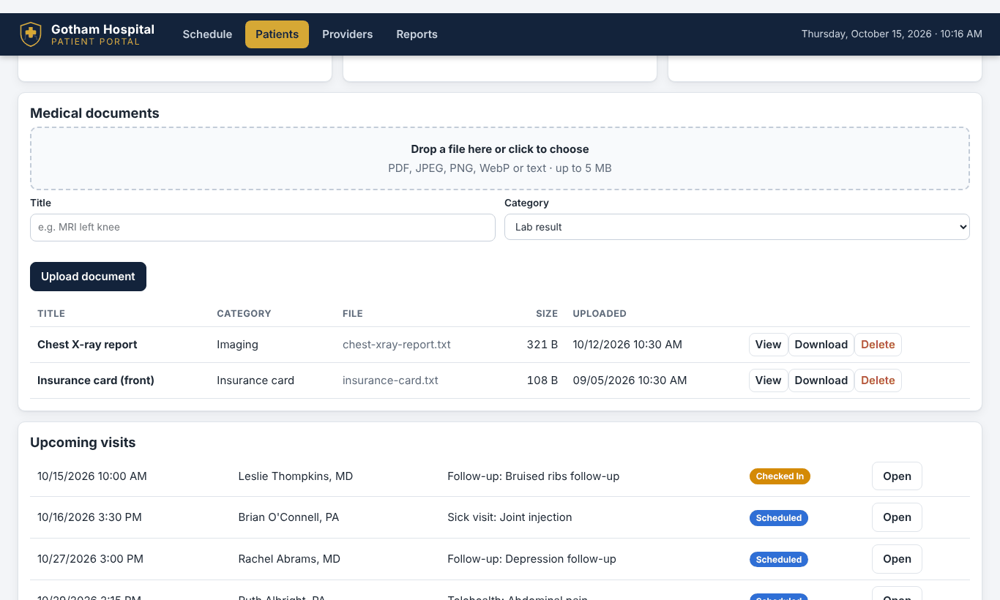
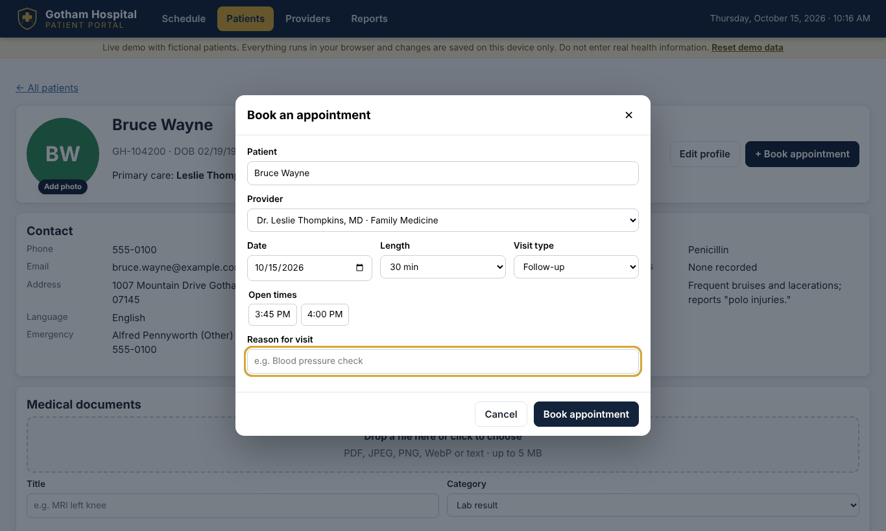
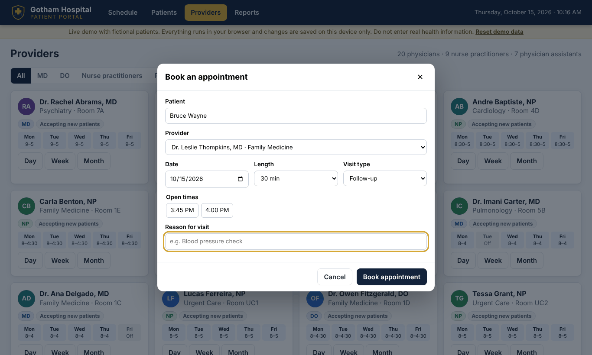
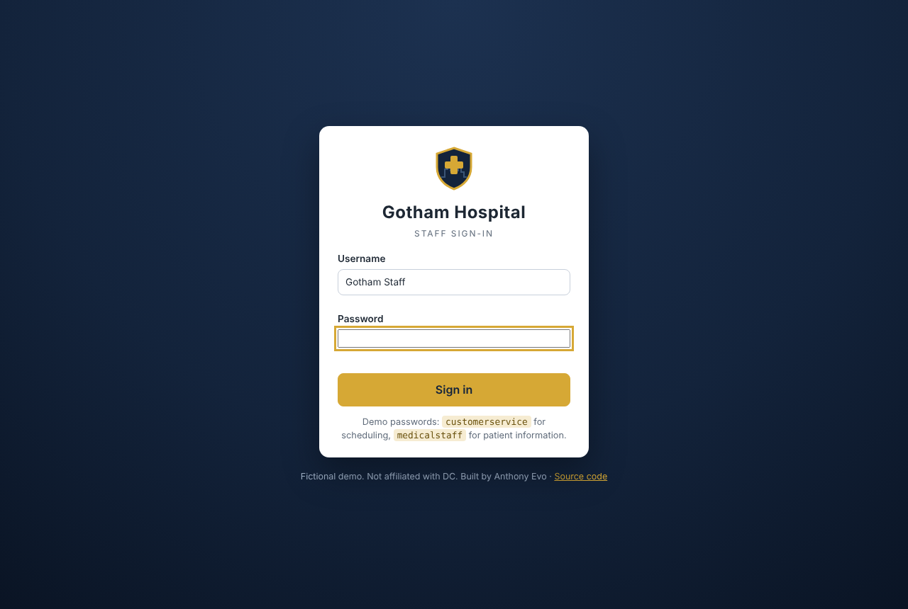
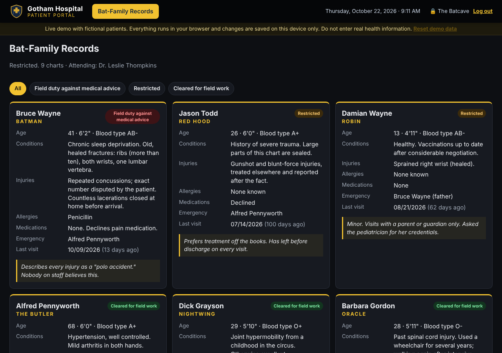

# Gotham Hospital Patient Portal

**▶ [Live demo](https://theoyanvno.github.io/clinic-appointment-tracker/)**

A clinic scheduling and patient records app for a busy outpatient clinic, based on my work as a Senior Medical Assistant. Gotham Hospital has 36 providers (physicians, nurse practitioners and physician assistants) open Monday–Friday, about 2,400 patients and six weeks of appointments. Staff can view any provider's schedule by day, week or month, book visits into open times, check patients in, and keep patient profiles with insurance, a photo and uploaded medical documents.

**Tech:** SQL (SQLite) · Node.js REST API (built-in `http`, no frameworks) · vanilla JavaScript (ES modules) · sql.js (SQLite in WebAssembly) · IndexedDB · `node:test`



| One provider's week | Month view |
|---|---|
|  |  |
| **Patient profile** | **Medical documents** |
|  |  |
| **Booking into open times** | **36 providers** |
|  |  |
| **Staff sign-in (loads first)** | **Bat-Family Records (third password)** |
|  |  |

## Features

- **36 providers:** 16 MD, 4 DO, 9 nurse practitioners and 7 physician assistants across 16 specialties, each with their own weekly hours, days off and lunch break
- **Business hours:** Monday–Friday, 8:00 AM–5:00 PM; weekends are closed
- **Schedules by day, week or month:**
  - all providers on one day (provider rows by quarter hour), or one provider's day
  - one provider's week, or all providers' week showing how full each day is
  - a month calendar with visit counts
- **Booking** shows only a provider's open times and explains why a time can't be booked (weekend, outside hours, lunch, already booked, in the past)
- **Visit status:** check in, complete, no-show, cancel and reinstate
- **Patient profiles:** demographics, contact and emergency contact, primary care provider, allergies, medications, and primary and secondary insurance (payer, plan, member ID, group, subscriber, copay)
- **Patient photo upload**, cropped and resized in the browser before saving
- **Medical document upload:** PDF, image or text files up to 5 MB, by button or drag and drop, with a title and category (lab result, imaging, referral and more); view, download or delete
- **Reports:** today's visits, check-ins, no-show rate, and each provider's workload over a date range
- **Staff sign-in comes first:** nothing loads until someone signs in. Everyone uses the username **Gotham Staff**, and the password decides what opens:

| Password | Role | Sees |
|---|---|---|
| `customerservice` | Customer service | Schedule, booking, check-in, providers and reports. Patient names for booking, but not their charts |
| `medicalstaff` | Medical staff | Patient profiles, insurance, clinical notes and documents (including deleting documents), and the schedule to read |

A third password opens **Bat-Family Records**, a dark "Batcave" view of the Bat-family's real charts (who's under which mask, injuries, allergies, and whether they're cleared for field work), and nothing else. Hint: it's Gotham's most famous resident, in lowercase.

The API enforces the same rules: no session returns `401`, and a role asking for something outside its permissions returns `403`.

Patients include DC Comics characters (Bruce Wayne's chart notes "frequent bruises; reports polo injuries") alongside generated patients.

## How it works

```
Browser (vanilla JS) ──► api() ──┬─ Node server: fetch → src/server.js ──┐
                                  │                                       ├─► src/routes.js ─► ClinicRepository ─► driver ─► SQLite
                                  └─ Live demo: local.js (in the browser) ┘                                   node:sqlite or sql.js
```

- **One router, two places.** [`src/routes.js`](src/routes.js) is a plain function from request to `{ status, body }`. The Node server calls it for HTTP requests; the live demo calls it directly in the browser. Validation, status codes (200, 201, 400, 404, 409) and SQL are identical in both.
- **One repository, two engines.** [`ClinicRepository`](src/ClinicRepository.js) owns every SQL statement and talks to a four-method driver: [`node:sqlite`](src/db/nodeDriver.js) on the server, [`sql.js`](src/db/sqljsDriver.js) in the browser. The tests run against both engines.
- **Staff sign-in.** Passwords are never stored: each account keeps a random salt and a PBKDF2-HMAC-SHA256 hash ([`src/auth.js`](src/auth.js), checked against Node's `crypto` in the tests). Sign-in creates a random 256-bit session token that expires after 8 hours, and logging out deletes it. On the Node server the token lives only in an `HttpOnly`, `SameSite=Strict` cookie, so page scripts can't read it; the static live demo has no server, so it keeps the token in `localStorage`. Several roles share the "Gotham Staff" username, so sign-in checks the password against each role's hash and the match decides the role. Each role's permissions ([`src/seed/staff.js`](src/seed/staff.js)) are checked by the router on every request, and the front end uses the same list to hide tabs and buttons.
- **The live demo** builds the clinic in the browser on first visit (about 2 seconds), then saves the database in IndexedDB after each change, so bookings and new patients survive a refresh. "Reset demo data" starts over.

## SQL highlights

[`sql/schema.sql`](sql/schema.sql) has 7 related tables: clinic hours, providers, provider hours, patients, insurance, appointments and documents.

- `CHECK` constraints for credentials, sex, visit types, durations, statuses and the 5 MB document limit
- A **partial unique index** so a provider can't have two active visits at the same time, while a cancelled slot can be booked again
- An **overlap query** that finds any visit starting before the new one ends and ending after it starts, for the provider and for the patient
- `INSERT … ON CONFLICT DO UPDATE` (upsert) for primary and secondary insurance
- Documents stored as `BLOB`s; `GROUP BY` with conditional sums, `NULLIF` and `HAVING` for reports; a CTE for weekly utilization ([`sql/queries.sql`](sql/queries.sql))
- Every query is parameterized (`?`) to prevent SQL injection, and multi-step writes run in transactions

## API

| Method | Endpoint | Description |
|---|---|---|
| POST | `/api/login` | Staff sign-in with `{ username, password }`; sets the session cookie |
| POST | `/api/logout` | Ends the session |
| GET | `/api/me` | The signed-in staff member, or `{ staff: null }` |
| GET | `/api/clinic` | Business hours and today's summary |
| GET | `/api/providers?credential=NP&q=…` | Providers with weekly hours |
| GET | `/api/providers/:id/slots?date=&duration=` | Open start times for a provider and day |
| GET | `/api/appointments?from=&to=&providerId=` | Appointments in a date range |
| GET | `/api/appointments/counts?from=&to=` | Visits per day, for the month view |
| POST | `/api/appointments` | Book: `{ patientId, providerId, startsAt, duration, visitType, reason }` |
| PATCH | `/api/appointments/:id/status` | `{ status: "checked_in" }` |
| GET / POST | `/api/patients` | Search (name, MRN or birth date) / create with insurance |
| GET / PUT | `/api/patients/:id` | Full profile with insurance, visits and documents / update |
| PUT | `/api/patients/:id/photo` | `{ photo: "data:image/jpeg;base64,…" }` or `null` to remove |
| GET / POST | `/api/patients/:id/documents` | List / upload `{ title, category, fileName, mimeType, dataBase64 }` |
| GET / DELETE | `/api/documents/:id` | Download (base64) / delete (delete is staff only) |
| GET | `/api/reports/workload?from=&to=` | Visits, completed, no-shows and no-show rate per provider (staff only) |

## Run it

Requires Node.js 22.13 or newer (it uses the built-in `node:sqlite` module, so there is nothing to install).

```bash
npm start            # Node server at http://localhost:3000 (creates clinic.db with sample data)
npm test             # 44 tests, run on both node:sqlite and sql.js
npm run build:site   # build the in-browser version into docs/ for GitHub Pages
npm run preview      # try that version at http://localhost:4000
```

## Project structure

| Path | What it does |
|---|---|
| `sql/` | Schema and example report queries |
| `src/ClinicRepository.js` | Every SQL statement: providers, patients, insurance, appointments, documents, reports |
| `src/routes.js` | REST routes shared by the server and the browser |
| `src/auth.js` | Password hashing (PBKDF2-HMAC-SHA256) and session tokens, same code in Node and the browser |
| `src/validation.js` | Input rules for appointments, patients, photos and documents |
| `src/schedule.js` | Date and time helpers (weeks, month grid, quarter hours) |
| `src/seed/` | Sample providers, DC character patients and the appointment generator |
| `public/js/` | Front end: schedule views, booking, patient form, documents, providers, reports |
| `public/js/local.js` | Live demo backend: sql.js + IndexedDB |
| `public/js/staff.js` | Hidden staff sign-in dialog, top-bar badge and log out |
| `test/` | Repository, scheduling, API, validation and sign-in tests |

## Notes

- The demo passwords are public on purpose. A real deployment would add sign-in rate limiting, HTTPS and accounts managed by an administrator.
- All people, phone numbers (555-01xx), addresses, insurance plans and medical details are fictional. Do not enter real health information; this is a portfolio demo, not a HIPAA-compliant system.
- Patient names are DC Comics characters used for fun. Gotham Hospital is not affiliated with DC.
- sql.js 1.10.3 (MIT) is included in [`public/vendor/`](public/vendor).

Built with help from AI coding tools for planning, code review and tests.
